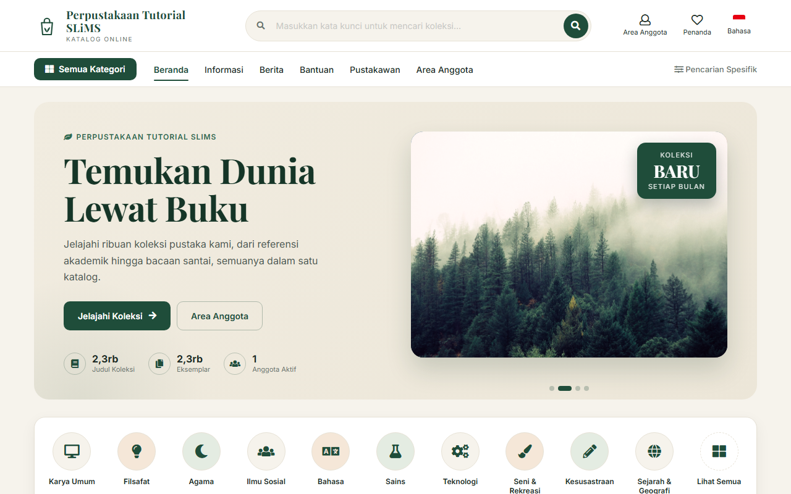

# Modern Library

Template OPAC untuk **SLiMS 9.8.0** bergaya katalog modern: perpaduan hijau tua dan krem,
judul serif (Playfair Display), dan teks Inter. Mendukung dua bahasa (Indonesia / English)
dan responsif di HP, tablet, maupun desktop.

Dibuat oleh **Tutorial SLiMS**.

## Fitur

**Beranda**
- Hero dengan **etalase buku**: sampul koleksi terbaru berganti otomatis, lengkap dengan judul, pengarang, dan tautan detail
- Statistik perpustakaan langsung dari database (jumlah judul, eksemplar, anggota aktif)
- Ikon kategori DDC (000–900) dan modal "Semua Kategori"
- **Koleksi Populer** (berdasarkan jumlah peminjaman; tetap tampil walau belum ada transaksi) dan **Koleksi Baru**
- Banner promo, pembaca terbaik, banner pencarian, peta lokasi, dan strip layanan
- **Popup Statistik** (ikon grafik di header, tersedia di semua halaman): pengunjung dan peminjaman hari ini/7 hari terakhir/bulan ini/total, langsung dari database, dimuat lewat AJAX saat dibuka

**Pencarian**
- **Saran koleksi langsung** saat mengetik: judul, pengarang, tahun, dan nomor panggil, dengan sorotan kata kunci
- Navigasi keyboard (↑ ↓ Enter, Esc)
- Pilih kolom: Semua, Judul, Pengarang, Subjek, ISBN/ISSN, Penerbit, **Nomor Panggil Rak**
- Kata kunci dan kolom tetap terisi di halaman hasil
- Riwayat pencarian (bisa dihapus) dan tautan ke seluruh koleksi

**Buku Tamu** (`index.php?p=visitor`)
- Tampil satu tema dengan beranda: header, menu, hero krem, dan footer yang sama
- Jam digital serta statistik pengunjung hari ini, bulan ini, dan total
- Kartu hasil check-in dengan foto anggota; tamu non-anggota dan input yang salah menampilkan gambar logo (`assets/images/guest-visitor.jpg`, bisa diganti)
- Panduan pengisian, kutipan inspiratif, dan banner promo

**Halaman lain**
- Hasil pencarian dengan panel filter, halaman detail, informasi, berita, dan area anggota bergaya seragam
- Halaman login anggota dua kolom

## Kebutuhan

- SLiMS 9.8.0
- Ekstensi PHP **gettext** aktif (wajib untuk SLiMS)
- Koneksi internet (font Inter dan Playfair Display dimuat dari Google Fonts)

## Cara pasang

1. Buka halaman [**Releases**](https://github.com/tutorialslims/template-modern_library/releases/latest)
   dan unduh berkas ZIP versi terbaru (mis. `modern_library-v1.1.0.zip`).
2. Ekstrak, lalu salin folder `modern_library` ke folder `template/` di instalasi SLiMS Anda
   sehingga hasilnya `slims/template/modern_library/`.
   > Jika mengunduh lewat tombol **Code → Download ZIP**, ganti dulu nama folder hasil ekstrak
   > (`template-modern_library-main`) menjadi `modern_library`.
3. Login ke Admin SLiMS, buka **Sistem → Template**.
4. Pada kartu **modern_library**, klik **Aktifkan**.
5. Muat ulang halaman OPAC (Ctrl + F5).

> Logo diambil dari pengaturan SLiMS (Sistem → Pengaturan Sistem → Logo).

## Pengaturan

Buka **Sistem → Template → Pengaturan** pada kartu Modern Library untuk mengubah:
- Judul dan deskripsi hero, teks lencana "Koleksi Baru"
- Judul dan deskripsi banner pencarian
- Jumlah koleksi populer/baru, peta lokasi, tautan media sosial, dan teks "Tentang Kami"

## Kustomisasi

| Yang diubah | Lokasi |
| --- | --- |
| Warna & ukuran | `assets/css/theme.css` (variabel `--ml-*` di `:root`) |
| Gambar cadangan hero | `assets/images/slide1.jpg` … `slide4.jpg` (dipakai bila belum ada koleksi bersampul) |
| Susunan beranda | `parts/_home.php` |
| Header & menu | `parts/_navbar.php` |
| Kotak pencarian | `parts/_search-form.php`, `parts/_suggest.php` |
| Footer | `parts/footer.php` |

## Catatan

- Jika situs menampilkan **"Oops Error"** di semua halaman, kemungkinan ekstensi PHP `gettext`
  belum aktif. Aktifkan `extension=gettext` di `php.ini`, lalu restart web server.
- Tautan menu **Layanan** di footer hanya muncul bila ada halaman konten berpath `services`
  (Sistem → Konten). Jika belum ada, diganti tautan **Bantuan**.

## Pembaruan

### v1.2.0 — Popup Statistik Pengunjung & Peminjaman

**Baru**
- **Popup Statistik** lewat ikon grafik di header (tersedia di semua halaman OPAC): pengunjung
  dan peminjaman hari ini, 7 hari terakhir, bulan ini, dan total sepanjang waktu, termasuk jumlah
  eksemplar yang sedang dipinjam.
- Data diambil langsung dari database lewat endpoint JSON, dan hanya dimuat saat popup dibuka
  (bukan di setiap kunjungan halaman), agar tidak membebani database.

**Cara memperbarui dari v1.1.0:** unduh ZIP v1.2.0 dari halaman
[Releases](https://github.com/tutorialslims/template-modern_library/releases), ekstrak, lalu timpa
folder `template/modern_library` di instalasi SLiMS Anda. Pengaturan template yang tersimpan di
database tetap dipakai.

Catatan rilis lengkap: [v1.2.0](https://github.com/tutorialslims/template-modern_library/releases/tag/v1.2.0).

### v1.1.0 — Pembaruan template Modern Library

**Baru**
- **Halaman Buku Tamu** (`index.php?p=visitor`) kini bertema sama dengan beranda: header, menu,
  hero krem, dan footer yang seragam.
- **Jam digital dan statistik pengunjung** hari ini, bulan ini, dan total.
- **Kartu hasil check-in** dengan foto anggota. Tamu non-anggota dan input yang salah menampilkan
  gambar logo perpustakaan (`assets/images/guest-visitor.jpg`, bisa diganti dengan gambar Anda).
- **Panduan pengisian, kutipan inspiratif, dan banner promo** di halaman Buku Tamu.
- **Kode aktivasi template**, diisi di Admin SLiMS → Sistem → Template → Modern Library → Pengaturan.

**Perbaikan**
- Halaman login staf, 2FA, lupa sandi, dan atur sandi baru selalu bisa diakses.
- Pembaruan pustaka pendukung tema dan perbaikan kecil lainnya.

**Cara memperbarui dari v1.0.0:** unduh ZIP v1.1.0 dari halaman
[Releases](https://github.com/tutorialslims/template-modern_library/releases), ekstrak, lalu timpa
folder `template/modern_library` di instalasi SLiMS Anda. Pengaturan template yang tersimpan di
database tetap dipakai.

Catatan rilis lengkap: [v1.1.0](https://github.com/tutorialslims/template-modern_library/releases/tag/v1.1.0).

## Kredit

Template ini dibangun di atas struktur template bawaan SLiMS
(Waris Agung Widodo, Arie Nugraha, dan kontributor SLiMS lainnya) dan memakai
pustaka open source berikut di folder `assets/`:

| Pustaka | Lisensi |
| --- | --- |
| [Bootstrap](https://getbootstrap.com) | MIT |
| [jQuery](https://jquery.com) | MIT |
| [Vue.js](https://vuejs.org) | MIT |
| [Popper.js](https://popper.js.org) | MIT |
| [Axios](https://axios-http.com) | MIT |
| [Masonry](https://masonry.desandro.com) | MIT |
| [Vegas](https://vegas.jaysalvat.com) | MIT |
| [Tailwind CSS](https://tailwindcss.com) | MIT |
| [Font Awesome Free](https://fontawesome.com) | Ikon CC BY 4.0, font SIL OFL 1.1, kode MIT |
| [flag-icons](https://github.com/lipis/flag-icons) | MIT |

## Kontak

Apapun masalah error SLiMS, kami siap membantu, silakan DM ke Instagram.

- Email: tutorialslims@gmail.com
- Instagram: [@tutorial_slims](https://instagram.com/tutorial_slims)

## Lisensi

[GPL-3.0](LICENSE), mengikuti lisensi SLiMS.
